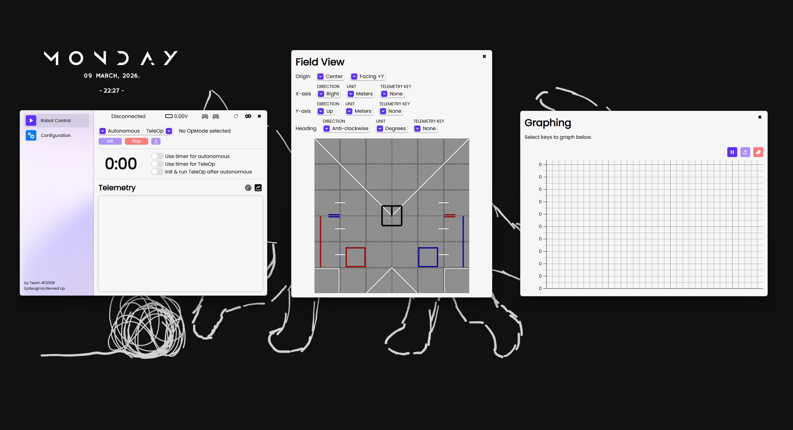

# FTC Driver Station for PC

This is a desktop version of the driver station app used for FIRST Tech Challenge to control a robot.
It can be used without installation of any additional software on the robot, as it uses the same protocol as the mobile driver station app does.



## Developing the app

Prerequisites: you must have [NodeJS](https://nodejs.org/ens) installed

- Clone the repository with `--recurse-submodules`
- Run `npm install` to download project dependencies
- Run `npm run build` to build the app
- Start the app using `npm start`

## Keyboard controller

If a hardware gamepad is not available, the app can send a synthetic gamepad from the keyboard.
Use the `K1` or `K2` button in the status bar to assign the keyboard to driver slot 1 or 2.

| Gamepad input | Keyboard input |
| --- | --- |
| Left stick | `W`, `A`, `S`, `D` |
| Right stick | Arrow keys |
| A / B / X / Y | `Space`, `B`, `X`, `Y` |
| Left / right bumper | `Q`, `E` |
| Left / right trigger | `Z`, `C` |
| Start / back | `Enter`, `Backspace` |
| Left / right stick button | `Shift`, `Control` |
| D-pad | `I`, `J`, `K`, `L` |

## Gamepads

Press `Start` + `A` to bind a gamepad as gamepad 1, or `Start` + `B` for gamepad 2 (on PlayStation-style pads: `Options` + `Cross` / `Options` + `Circle`).
Controllers that Chromium does not map to the standard layout (gamepad mapping `""`) are normalized when they use the DS4-style generic HID layout, e.g. the ZEROPLUS P4 Wired Gamepad (`0c12:2e18`) on Linux with `hid-generic`.
Hover the gamepad icon to see which controller is bound and which layout was detected.

Rumble effects from the robot (`gamepad1.rumble(...)` etc.) use the browser vibration API when the controller supports it.
On Linux, DS4-layout controllers without kernel force feedback are driven directly through `/dev/hidrawN`; this needs read/write access to that device, for example with a udev rule:

```
# /etc/udev/rules.d/70-ftc-ds-gamepad.rules  (example for the ZEROPLUS P4)
KERNEL=="hidraw*", ATTRS{idVendor}=="0c12", ATTRS{idProduct}=="2e18", TAG+="uaccess"
```

Debugging: start the app with `FTCDS_GAMEPAD_DEBUG=1` (or press `Ctrl+Shift+G`) to log raw gamepad input, and `FTCDS_RUMBLE_DEBUG=1` to log rumble output.
